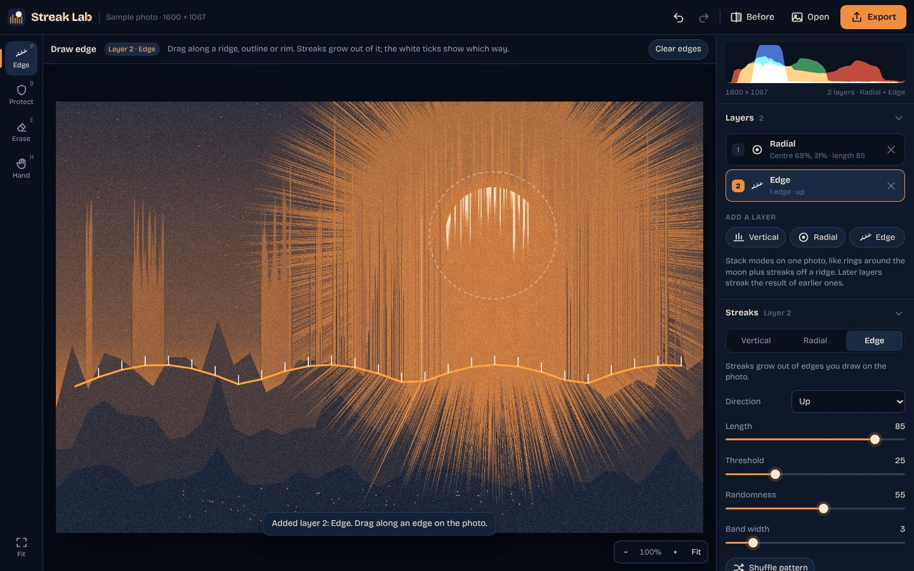
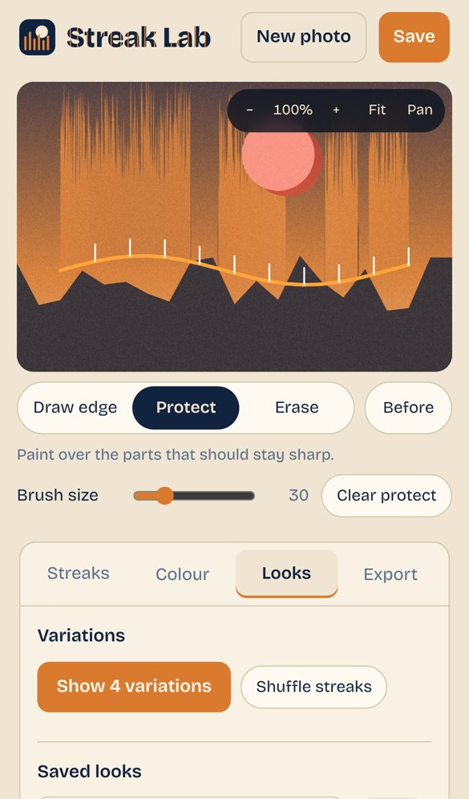

# Streak Lab

Turn photos into pixel-streak art for Instagram. Pull pixels straight up, around a centre point, or out of any edge you draw, grade the result in two tones with grain, then export a full-size photo, a carousel or a Reel.

**Live: [jamies.dev/streak-lab](https://jamies.dev/streak-lab/)**



Everything runs in your browser. Photos are never uploaded anywhere.

## How to use it

Streak Lab works like a photo editor: the photo sits in the middle, the tools are on the left (along the bottom on a phone), and the adjustment panels are on the right (behind the tabs at the bottom on a phone).

1. **Open a photo**, or tap **Try a sample**. On a computer you can also drop or paste one. A short three-step guide appears the first time.
2. **Place the streaks** with the first tool. It's called **Line**, **Centre** or **Edge** depending on the mode:
   - **Vertical**: tap or drag to set the line the streaks rise from.
   - **Radial**: tap or drag to set the centre of the rings.
   - **Edge**: drag along a ridge, treetop, outline or the rim of the moon, then pick a Direction. The white ticks show which way the streaks go.
     - **Snap to outlines** (on by default) pulls a roughly drawn edge onto the nearest real outline in the photo.
     - **Auto-trace horizon** finds the strongest horizon, skyline or ridge line across the whole photo in one tap.
3. **Layers** let you combine modes on one photo, such as Radial rings around the moon plus Edge streaks off a ridge. Add up to 4 layers. Each has its own mode, sliders, edges, **opacity** and **blend mode** (Normal, Lighten, Screen, Darken), and later layers streak the result of earlier ones.
4. **Streaks**: Length, Threshold (how bright a pixel must be to streak), Randomness and Band width. **Shuffle pattern** tries a new random pattern. Double-click or double-tap a slider's name to reset it.
5. **Protect** keeps parts sharp. Choose **Brush** to paint, or **Tap subject** and tap a person, animal or object: an AI model running on your device (Google's MediaPipe) finds its outline. The model downloads once (about 15 MB) and then works offline. **Erase** removes protect paint and cuts away parts of edges. Hold **Before** to compare with the original.
6. **Colour**: pick shadow, mid and highlight colours or a palette, then set the duotone strength and grain.
7. **Looks**: tap a starter look, previewed on your own photo; render 4 variations of your edit; or save your own looks so a whole series matches.
8. **Export** opens a dialog with three options:
   - **Photo**: full resolution as JPEG or PNG. Photos over 16 megapixels are saved as PNG.
   - **Carousel**: 1080 × 1350 Instagram slides showing the finished photo, the original, your edges and two variations.
   - **Video**: a silent clip for Reels, Stories or the feed. **Preview** plays it without recording. Safari and Chrome record MP4. There are 8 animations:
     - **Streaks grow**: the streaks grow out of the original photo.
     - **Before/after wipe**: a line sweeps across from the original to the finished photo.
     - **Streaks breathe** (loops): the streaks grow and shrink back.
     - **Slow push-in**: the camera slowly zooms toward the streaks.
     - **Colour cycle** (loops): cross-fades through the palettes.
     - **Stop-motion streaks** (loops): flicks through new random streak patterns.
     - **Glitch reveal**: the original breaks into glitchy slices that settle into the finished photo.
     - **Beat cuts**: cuts between finished, original and variations on every beat, at a BPM you set.
   - Videos come in 9:16, 4:5 or 1:1, at 5, 7, 10 or 15 seconds, showing the whole photo or filling the frame.
   - A tick box adds a small "Made with Streak Lab" credit to slides and videos. It is off by default.

**Undo and redo** cover sliders, colours, layers, edges and protect paint.

**Your work is kept.** The current photo and edit are saved on your device (in the browser's storage, never uploaded), so closing the tab or reloading picks up where you left off. Opening a new photo replaces it.

**Works offline.** Once the app has loaded, a service worker caches it, so the home-screen app opens without a connection, including the subject finder once it has been used.

**Zoom**: pinch, scroll, or use + and −. Two fingers move the photo, or use the **Hand** tool.

### Keyboard shortcuts

| Key | Action |
| --- | --- |
| Ctrl/⌘ Z, Ctrl/⌘ Shift Z | Undo, redo |
| P / B / E / H | Place, Protect, Erase, Hand tools |
| Hold Space | Hand tool while held |
| Hold `\` | Show the original |
| `[` `]` | Smaller or larger brush |
| 0 | Fit the photo to the screen |
| Ctrl/⌘ E | Export |

### Install it on your phone

- **iPhone or iPad**: open the site in Safari, tap Share, then **Add to Home Screen**.
- **Android**: in Chrome, open the menu and tap **Install app** or **Add to Home screen**.

Saving uses the share sheet where the browser supports it, so you can send images and Reels straight to Photos or Instagram. Elsewhere it downloads the files.



## Development

It's a single static `index.html` with no framework, no build step and no dependencies apart from a Google Font. To run it locally, serve the folder with any static server:

```sh
python3 -m http.server 8000
# then open http://localhost:8000/
```

Opening `index.html` straight from disk also works, but the web app manifest needs a server.

| File | Purpose |
| --- | --- |
| `index.html` | The whole app: markup, styles and script |
| `manifest.webmanifest` | Lets the app be installed to a home screen |
| `icons/` | Favicon, Apple touch icon and app icons |
| `og-image.png` | Preview image for links shared on social media |
| `sw.js` | Service worker that caches the app for offline use |
| `.nojekyll` | Tells GitHub Pages to serve the files as they are |

The site is published with GitHub Pages from the root of the `main` branch. Because the `cijamie.github.io` user site uses the custom domain `jamies.dev`, the app is served at `https://jamies.dev/streak-lab/`.

## Licence

[MIT](LICENSE)
